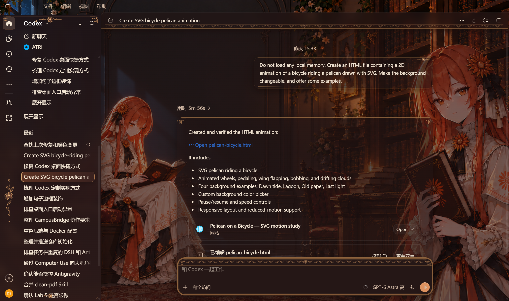
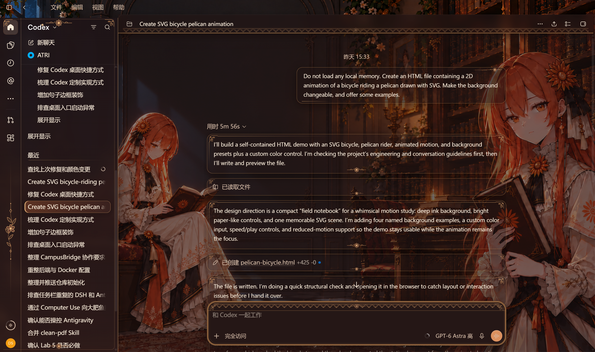
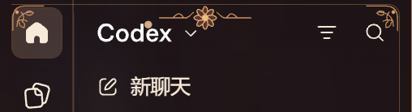
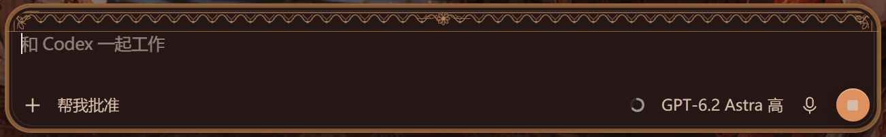

# Claude 娘 · 橘花书房

橘花书房是 [Codex Dream Skin](https://github.com/Fei-Away/Codex-Dream-Skin) 的浅色与深色主题。阅读中的 Claude 娘坐在书房一侧，另一侧是持书半身像，中间留给会话正文。

## Atelier 装饰效果

以下是 Windows 上使用 [Atelier 定制引擎](https://github.com/X-Immortal/Codex-Dream-Skin/tree/d4e3e07047ce5565fce8e01b6ed1cdd59d80c29e)的深色主题全窗口截图。

**新聊天首页**

**制作 SVG 动画时的对话**

展开查看工具调用和装饰细节

| 浅色背景 | 深色背景 |
| --- | --- |
|  |  |

## 安装

先按上游的 [Windows 安装说明](https://github.com/Fei-Away/Codex-Dream-Skin/blob/main/docs/install-windows.md)或 [macOS 安装说明](https://github.com/Fei-Away/Codex-Dream-Skin/blob/main/docs/install-macos.md)安装 Dream Skin，再下载[浅色主题 ZIP](https://github.com/X-Immortal/claude-atelier-theme/releases/download/v4/claude-maid-atelier-light-v4.zip) 或[深色主题 ZIP](https://github.com/X-Immortal/claude-atelier-theme/releases/download/v4/claude-maid-atelier-dark-v4.zip)。在 Windows 托盘或 macOS 菜单栏的 Dream Skin 菜单中选择“导入主题 ZIP…”，然后在“已保存主题”中应用对应主题。

下载本主题仓库后，可以打开[本地预览](preview/index.html)切换浅色和深色布局。

## 图像署名

角色原设出自 B 站 [@ZipZipPipe](https://space.bilibili.com/4168597) 的[《AI娘化》](https://www.pixiv.net/artworks/148186519)，设定图取自 @lmy414 的 [ai-chan-sheets](https://github.com/lmy414/ai-chan-sheets)。界面参考了 [maid-atelier](https://github.com/Small-tailqwq/dsh-deep-whale/tree/dc561129f3bb3bc94c4a7c3e4007eaa274650d31/maid-atelier)。

两幅书房背景使用 OpenAI GPT Image 生成，改编贡献按 [CC BY-NC-SA 4.0](https://creativecommons.org/licenses/by-nc-sa/4.0/deed.zh-hans) 共享。
