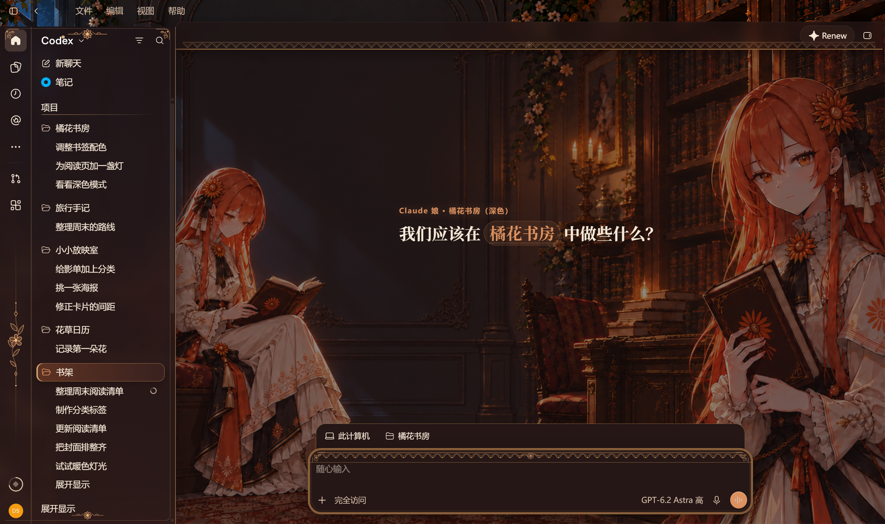

# Claude 娘 · 橘花书房

橘花书房是适用于 [Codex Dream Skin](https://github.com/Fei-Away/Codex-Dream-Skin) 的浅色与深色主题包。阅读中的 Claude 娘位于书房背景两侧，中间区域留给会话正文与输入框。

## 效果预览

直接导入本主题 ZIP 即可在 Codex Dream Skin 中生效书房背景、主题配色与卡片样式；下方实机截图同时展示了个人分支（[`atelier-local`](https://github.com/X-Immortal/Codex-Dream-Skin/tree/atelier-local)）额外绘制的侧栏橘花、金线框与输入框花边。

**新聊天首页**

**对话界面**

**工具调用展开状态**

| 浅色背景（`claude-maid-atelier`） | 深色背景（`claude-maid-atelier-dark`） |
| --- | --- |
|  |  |

## 安装

1. 按 [Codex Dream Skin](https://github.com/Fei-Away/Codex-Dream-Skin) 的 [Windows 安装说明](https://github.com/Fei-Away/Codex-Dream-Skin/blob/main/docs/install-windows.md) 或 [macOS 安装说明](https://github.com/Fei-Away/Codex-Dream-Skin/blob/main/docs/install-macos.md) 安装客户端（[Releases](https://github.com/Fei-Away/Codex-Dream-Skin/releases)）。
2. 前往本仓库 [v4 发布页](https://github.com/X-Immortal/claude-atelier-theme/releases/tag/v4) 下载主题包，或直接下载：
   - 浅色主题：[claude-maid-atelier-light-v4.zip](https://github.com/X-Immortal/claude-atelier-theme/releases/download/v4/claude-maid-atelier-light-v4.zip)
   - 深色主题：[claude-maid-atelier-dark-v4.zip](https://github.com/X-Immortal/claude-atelier-theme/releases/download/v4/claude-maid-atelier-dark-v4.zip)
3. 在 Windows 系统托盘或 macOS 菜单栏打开 Dream Skin 菜单，选择“导入主题 ZIP…”，导入后在“已保存主题”中应用。

下载本仓库后，也可以用浏览器打开[本地静态预览](preview/index.html)切换浅色与深色布局。

## 仓库结构

- `light/`：浅色主题源文件（`background.png`、`theme.css`、`theme.json`）
- `dark/`：深色主题源文件（`background.png`、`theme.css`、`theme.json`）
- `preview/`：脱离客户端运行的[静态 HTML 预览页](preview/index.html)
- `docs/`：[视觉设计说明](docs/DESIGN.md)与实机截图

## 素材来源与署名

- **角色原设**：B 站 [@ZipZipPipe](https://space.bilibili.com/4168597)（胖次狐）创作的[《AI娘化》](https://www.pixiv.net/artworks/148186519)。画师允许取用与再创作，要求保留作者署名且不可商用（参见[作者再创作说明](https://www.bilibili.com/video/BV1bARXBYEZz/)）。
- **角色设定图**：GitHub [@lmy414](https://github.com/lmy414) 整理的 [ai-chan-sheets](https://github.com/lmy414/ai-chan-sheets)，补全部分按 CC BY-NC-SA 4.0 授权，原图部分沿用 ZipZipPipe 的非商用条件（参见[仓库 LICENSE](https://github.com/lmy414/ai-chan-sheets/blob/51c15559ac7ebc6bbfb22e1769ba46716f976d5d/LICENSE)）。
- **界面视觉参考**：参考 [@Small-tailqwq](https://github.com/Small-tailqwq) 的 [maid-atelier](https://github.com/Small-tailqwq/dsh-deep-whale/tree/dc561129f3bb3bc94c4a7c3e4007eaa274650d31/maid-atelier) 在构图、边框与输入框上的设计语言。
- **书房背景图**：两幅背景图使用 OpenAI GPT Image 生成并重新编排书房场景、人物姿态与明暗配色，改编贡献按 [CC BY-NC-SA 4.0](https://creativecommons.org/licenses/by-nc-sa/4.0/deed.zh-hans) 共享。分享或再创作时请保留以上原作者署名与来源链接，注明修改内容，仅限非商业用途，并以相同许可协议分享改编部分。
